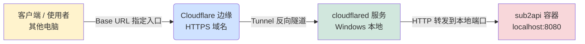

## 写作目的

折腾了一天一夜，终于玩明白sub2api了。

为了后续不再踩坑，在此记录

## 网络问题

sub2api在github上，官方给出了两种部署方式，一种是脚本部署，另一种是docker部署。但是里面的脚本中，就是下载github上面的文件，但是本地电脑并不能连接github。所以无奈只好使用手动源码构建。


## 本地运行

不必多说，本地先克隆sub2api仓库。

本地运行前置条件

- Go 1.21+
- Node.js 18+
- PostgreSQL 15+
- Redis 7

直接参考官方教程：

```bash
# 3. 编译前端
cd frontend
pnpm install
pnpm run build
# 构建产物输出到 ../backend/internal/web/dist/

# 4. 编译后端（嵌入前端）
cd ../backend
VERSION="$(./scripts/resolve-version.sh)"
go build -tags embed -ldflags="-X main.Version=${VERSION}" -o sub2api ./cmd/server

# 5. 创建配置文件
cp ../deploy/config.example.yaml ./config.yaml

# 6. 编辑配置
nano config.yaml
```

但是这里请注意！不要直接build，先本地跑起服务。

使用setup快速设置环境

```bash
go run ./cmd/server/ -setup
```

```bash
# 后端（支持热重载）
go run ./cmd/server

# 前端（支持热重载）
pnpm run dev
```

接下来，就该配置帐号了。

首先在账号管理配置订阅账号，然后进行分组


账号管理中，最下面一定要有这个分组的勾选，否则分组管理里面是0个账号可以使用，这个时候请求就会：

```
503 Service Temporal Unavailable
```


配置好后，给足额度，直接测试api-key是否可用

```json
    "localhost-sub2api": {
      "name":"sub2api",
      "baseUrl": "http://localhost:3000/v1",
      "apiKey": "sk-8f********************************************************5e",
      "api": "openai-completions",
      "models": [
        {
          "id": "deepseek-v4-flash-ga-260731",
          "name": "deepseek-v4-flash-ga-260731",
          "contextWindow": 1024000,
          "maxTokens": 384000,
          "input": ["text"]
        }
      ]
    }
```

## 公网部署

这个时候本地的中转站已经能正常代理我们的服务了。但是只能在本地电脑进行代理转发，要是换台电脑，那就不行了。

所以需要将本地的这个sub2api服务暴露给公网进行使用。

但是买一个服务器要我250，怎么办呢？

这个时候赛博佛祖来了——Cl Tunnel

如果你不会操作，可用参考开源skill：https://github.com/xiaoyuboi/cloudflare-tunnel-skill

但是我是手动操作的

1. 首先安装cl

    ```bash
    choco install cloudflared
    cloudflared --version
    ```

2. 登录

	```
	cloudflared tunnel login
	```

3. cl管理面板直接创建tunnel并绑定域名

	```
	cloudflared tunnel route dns sub2api sub2api.alexmaodali.dpdns.org
	```

	

4. 配置route

	

注意这里的route需要使用本地的http，并代理到前端。

整体链路：



其他电脑配置api-key:

```json
    "localhost-sub2api": {
      "name":"sub2api",
      "baseUrl": "https://apihub.alexmaodali.dpdns.org/v1",
      "apiKey": "sk-*********************************a45e",
      "api": "openai-completions",
      "models": [
        {
          "id": "deepseek-v4-flash-ga-260731",
          "name": "deepseek-v4-flash-ga-260731",
          "contextWindow": 1024000,
          "maxTokens": 384000,
          "input": ["text"]
        }
      ]
    }
```

至此，艺术已成

## 注意事项

测试的时候需要本地跑起前后端，还有tunnel

```
cloudflared tunnel run sub2api
curl -I https://sub2api.alexmaodali.dpdns.org
```

## 服务常驻

```powershell
# 注册为 Windows 服务（读取默认配置 C:\Users\<你>\.cloudflared\config.yml）
cloudflared service install

# 启动服务
net start cloudflared
# 或 Get-Service cloudflared | Start-Service

# 确认状态
Get-Service cloudflared
# Status 应为 Running，Startup Type 应为 Automatic
```

> 服务方式下隧道随 Windows 开机自动运行，不依赖终端窗口、不依赖 WSL。

## 常见错误

代理报错：

```
 Error: Retry failed after 3 attempts: 502
 {"type":"https://developers.cloudflare.com/support/troubleshooting/http-status-codes/cloudflare-5xx-errors/error-502/","title":"Error 502: Bad
 gateway","status":502,"detail":"The origin web server returned an invalid or incomplete response to Cloudflare. This typically indicates the
 origin is overloaded or
misconfigured.","instance":"a4c43eb3ed57eb31","error_code":502,"error_name":"origin_bad_gateway","error_category":"origin","ray_id":"a4c43eb3ed
 57eb31","timestamp":"2026-10-18T02:52:05Z","zone":"apihub.alexmaodali.dpdns.org","cloudflare_error":true,"retryable":true,"retry_after":60,"own
 er_action_required":true,"what_you_should_do":"**Wait and retry.** Back off for at least 60 seconds. If the error persists, the website
 operator should check their origin server health and configuration.","footer":"This error was generated by Cloudflare on behalf of the website
 owner."}
```

这样的报错最大可能就是代理没有配置好，端口，域名cname配置等，需要重点排查

请求报错：

```
 Error: 403 Blocked request. This host ("apihub.alexmaodali.dpdns.org") is not allowed.
 To allow this host, add "apihub.alexmaodali.dpdns.org" to `server.allowedHosts` in vite.config.js.
```

本地开发模式需要allowedHosts

加上即可：

```js
    server: {
      host: '0.0.0.0',
      port: devPort,
      // 放行通过隧道域名访问（允许该域下所有子域）
      allowedHosts: ['.dpdns.org'],
      proxy: {
        '/api': {
          target: backendUrl,
          changeOrigin: true
        },
        '/v1': {
          target: backendUrl,
          changeOrigin: true
        },
        '/setup': {
          target: backendUrl,
          changeOrigin: true
        }
      }
    }
```

## 最后的话

我原本以为把这个项目克隆下来，基本上加个支付就可以拿去售卖了，但没想到 sub2api 它只是一个基础的请求代理转发。

如果要做成商用产品，还需要自己开发用户体系和订单支付体系，并且需要单独接入网关来统计 token 的数量。

如果只是想单独快速做这样一个服务，可能还需要卡密。最重要的一点是还要去推广，所以这个东西实践起来还是挺麻烦的。

前段时间国内的一些中转站被查了，而且搞这个的话很容易进局子，所以目前对于这个项目的探索就到此为止吧。
